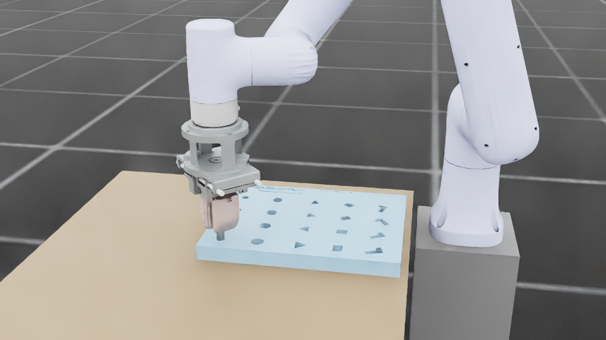
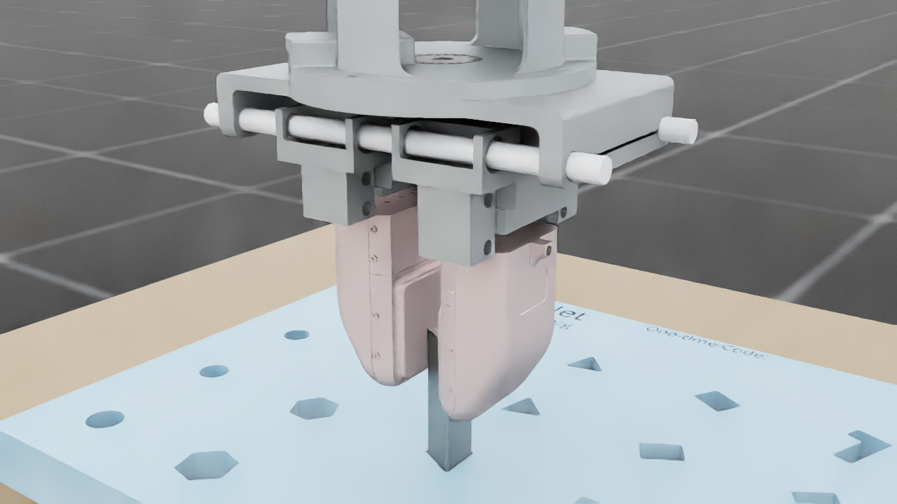

# nova5_2f85_tactile_sim

Simulation of a **Dobot NOVA5** robot arm with the CPS lab's **tactile gripper**
(a rack-and-pinion parallel gripper whose fingers are Daimon vision-based tactile
sensors, from [master-thesis-tactile-gripper](https://github.com/Cyber-physical-Systems-Lab/master-thesis-tactile-gripper))
in **NVIDIA Isaac Sim**, set up for the
**[ManipulationNet](https://manipulation-net.org) Peg-in-Hole** benchmark task
(NIST ATB M1 task board and steel pegs), with **Isaac Lab** environments for
reinforcement learning (RL). A Robotiq 2F-85 is kept as an alternative gripper.
Tactile signals are work in progress.





**Contents:** [What you get](#what-you-get) ·
[1. Requirements](#1-requirements) · [2. Install](#2-install-from-scratch) ·
[3. First run](#3-first-run) · [4. Train with RL](#4-train-a-policy-with-rl) · [Results](#results-so-far) ·
[5. The task in detail](#5-the-task-in-detail) · [The gripper model](#the-gripper-model) · [6. Repository layout](#6-repository-layout) ·
[7. Troubleshooting](#7-troubleshooting) · [Tactile](#tactile-work-in-progress) ·
[Limitations](#limitations) · [Credits](#credits-and-licences)

---

## What you get

| | |
|---|---|
| Robot | NOVA5 (Dobot's ROS 2 description) on a 0.70 m pedestal |
| Gripper (default) | CPS-lab tactile gripper, built from its CAD: two Daimon DM-Tac WL sensors as fingers on rack-driven carriages, coupled so they close symmetrically; 0–59.5 mm opening, 15 N grip. See [The gripper model](#the-gripper-model) |
| Gripper (alternative) | Robotiq 2F-85 from its URDF CAD (task names ending in `-2F85-v0`) |
| Benchmark | ManipulationNet Peg-in-Hole: the official board and peg CAD, 5 peg shapes (**A** circle, **B** hexagon, **C** triangle, **D** rectangle, **E** L-shape) × 4 clearance levels (**1** 3 mm, **2** 1 mm, **3** 0.1 mm, **4** 0.02 mm) = 20 sub-tasks, named like the benchmark (`A1` … `E4`) |
| RL environments | 20 Isaac Lab tasks `Nova5-MNet-PegInHole-A1-v0` … `-E4-v0` (tactile gripper) plus `…-A1-2F85-v0` … (2F-85), many robots in parallel on one GPU, PPO training with RSL-RL |
| Tools | scripted baseline, screenshot capture, asset builder, unit tests |

## 1. Requirements

| | Tested with | Notes |
|---|---|---|
| OS | Ubuntu 22.04 LTS | Isaac Sim also supports 24.04; not tested here |
| GPU | NVIDIA RTX A4500, 20 GB | An RTX-class GPU is required by Isaac Sim; ≥ 8 GB VRAM for small runs, more for many parallel envs |
| NVIDIA driver | 580.178 | Check with `nvidia-smi` |
| RAM / disk | 64 GB / ~40 GB free | Isaac Sim alone is ~20 GB unpacked |
| Isaac Sim | **6.0.0** (binary zip) | in `~/isaacsim` |
| Isaac Lab | **3.0.0**, commit `28a37ce` | in `~/IsaacLab` |
| Python | 3.12 (conda) | created by Isaac Lab's installer |

You do not need ROS. You need a desktop session (or a virtual display) to open
the Isaac Sim window; everything also runs headless.

## 2. Install from scratch

### 2.1 NVIDIA driver

```bash
nvidia-smi          # must print your GPU and a driver version
```

If it does not, install the recommended driver (`sudo ubuntu-drivers install`), reboot, and check again.

### 2.2 Miniconda

Skip if `conda --version` already works.

```bash
wget https://repo.anaconda.com/miniconda/Miniconda3-latest-Linux-x86_64.sh
bash Miniconda3-latest-Linux-x86_64.sh -b -p ~/miniconda3
~/miniconda3/bin/conda init bash
exec bash
```

### 2.3 Isaac Sim 6.0

1. Download the Isaac Sim **6.0** Linux zip from NVIDIA's
   [Isaac Sim download page](https://docs.isaacsim.omniverse.nvidia.com/latest/installation/download.html)
   (free NVIDIA account).
2. Unpack it to `~/isaacsim` and run the post-install steps:
   ```bash
   mkdir -p ~/isaacsim
   unzip ~/Downloads/isaac-sim-*.zip -d ~/isaacsim
   cd ~/isaacsim
   ./post_install.sh
   ```
3. Check that it starts (the first start compiles shaders and can take several minutes):
   ```bash
   ~/isaacsim/isaac-sim.sh
   ```

### 2.4 Isaac Lab 3.0

```bash
git clone https://github.com/isaac-sim/IsaacLab.git ~/IsaacLab
cd ~/IsaacLab
git checkout 28a37ce                 # version this repo was tested with
ln -s ~/isaacsim _isaac_sim          # tell Isaac Lab where Isaac Sim is
./isaaclab.sh --conda                # creates the conda env "env_isaaclab" (Python 3.12)
conda activate env_isaaclab
./isaaclab.sh --install              # Isaac Lab + RL libraries (rsl_rl, ...)
```

Check it (opens a window with an empty scene; close it to finish):

```bash
./isaaclab.sh -p scripts/tutorials/00_sim/create_empty.py --viz kit
```

### 2.5 This repository

```bash
git clone https://github.com/Cyber-physical-Systems-Lab/nova5_2f85_tactile_sim.git ~/nova5_tactile_sim
cd ~/nova5_tactile_sim
```

All Isaac commands in this repo go through `scripts/isaac_python.sh`, which
activates the conda env, loads Isaac Sim's Python setup and puts this repo on
`PYTHONPATH`. It assumes the paths above. If yours differ, set these
before running (or add them to `~/.bashrc`):

```bash
export ISAAC_PATH=~/isaacsim            # Isaac Sim folder
export ISAACLAB_PATH=~/IsaacLab         # Isaac Lab folder
export TASK_CONDA_ROOT=~/miniconda3     # conda installation
export TASK_CONDA_ENV=env_isaaclab      # conda env made by isaaclab.sh
```

### 2.6 Build the simulation assets (once, ~3 min)

You also need Daimon's STEP model of the **DM-Tac WL** sensor (the gripper's
fingers). It is a vendor file and not part of this repo: get the
`DM-Tac-W-STEP-…` package from Daimon (or from the lab) and point to it:

```bash
DAIMON_STEP="$HOME/Downloads/DM-Tac-W-STEP-20250417/DM-Tac WL.STEP" bash scripts/setup_assets.sh
```

Without `DAIMON_STEP` the fingers are plain boxes of about the same size. This needs internet access once. It:

1. clones the tactile gripper's CAD repository into `third_party/tactile_gripper`
   (pinned commit; not copied into this repo) and copies the sensor STEP into
   `third_party/daimon/`,
2. converts the gripper's Solid Edge assembly, its STEP parts and the sensor STEP
   to USD with Isaac Sim's built-in CAD converter (`scripts/convert_gripper_cad.py`),
3. builds `assets/generated/` (`scripts/build_assets.py`): both robots as single
   articulations, the five pegs, the board, one board per target hole with its
   collision geometry, and `peg_in_hole.json` with hole positions, measured
   clearances and gripper data.

Run `bash scripts/isaac_python.sh scripts/build_assets.py` again after pulling
changes to `nova5_tactile/`. Neither `third_party/` nor `assets/generated/` is in git.

### 2.7 Check the install

```bash
conda run -n env_isaaclab pip install pytest                 # once
bash scripts/isaac_python.sh -m pytest -q tests                # unit tests, no simulation, ~30 s
bash scripts/isaac_python.sh scripts/run_peg_in_hole.py --task A1 --num_envs 8 --headless
```

The second command should end with `EPISODE 0 success_rate` close to `1.0` (a scripted
policy inserting the peg in 8 parallel copies of the scene).

## 3. First run

```bash
# watch it in the Isaac Sim window (4 robots side by side)
bash scripts/isaac_python.sh scripts/run_peg_in_hole.py --task A1 --num_envs 4

# another sub-task: hexagon peg, 0.1 mm clearance
bash scripts/isaac_python.sh scripts/run_peg_in_hole.py --task B3 --num_envs 4

# headless, and save a picture
bash scripts/isaac_python.sh scripts/run_peg_in_hole.py --task A1 --num_envs 4 --headless \
    --enable_cameras --screenshot docs/media/peg_in_hole_A1.png
```

`run_peg_in_hole.py` options: `--task` (A1…E4), `--gripper cps_tactile|robotiq_2f85`,
`--num_envs`, `--episodes`, `--policy scripted|zero`, `--screenshot FILE` with
`--screenshot_step N` and optional `--eye X Y Z --lookat X Y Z` (camera relative
to the hole), `--trace N` (print env 0 state for N steps). The scripted policy centres the
peg over the hole from the observations, aligns its yaw and pushes down. It is
a sanity check and baseline, not a benchmark result.

## 4. Train a policy with RL

Isaac Lab's own training scripts are used; `scripts/train.py` and
`scripts/play.py` only register this repo's tasks and pass every other option
through.

```bash
# train PPO (RSL-RL) on A1 with 256 parallel envs, no window
bash scripts/isaac_python.sh scripts/train.py --rl_library rsl_rl \
    --task Nova5-MNet-PegInHole-A1-v0 --num_envs 256 --headless --max_iterations 300

# follow training curves (then open http://localhost:6006)
bash scripts/isaac_python.sh -m tensorboard.main --logdir logs/rsl_rl

# run the latest trained policy in the window
bash scripts/isaac_python.sh scripts/play.py --rl_library rsl_rl \
    --task Nova5-MNet-PegInHole-A1-v0 --num_envs 16
```

For the Robotiq 2F-85 use the `-2F85-` task names, e.g. `Nova5-MNet-PegInHole-A1-2F85-v0`.
Checkpoints are saved in `logs/rsl_rl/mnet_peg_in_hole/<date-time>/model_<iteration>.pt`;
`play.py` loads the newest one (or pass `--checkpoint PATH`). Watch
`Metrics/success_rate` (fraction of envs that inserted the peg during an
episode). Hyper-parameters: `nova5_tactile/mnet/agents/rsl_rl_ppo_cfg.py`.

You can also call Isaac Lab directly:
`./isaaclab.sh train --rl_library rsl_rl --task Nova5-MNet-PegInHole-A1-v0 --external_callback nova5_tactile.tasks.register`
(with this repo on `PYTHONPATH`).

## Results so far

Success = peg inserted ≥ 20 mm during the episode. RTX A4500.

**Scripted baseline** (`run_peg_in_hole.py`, 16 envs, 1 episode per sub-task),
CPS tactile gripper with DM-Tac WL fingers (2026-11-05):

| Shape \ level | 1 (3 mm) | 2 (1 mm) | 3 (0.1 mm) | 4 (0.02 mm) |
|---|---|---|---|---|
| A circle | 100 % | 88 % | 81 % | 0 % |
| B hexagon | 100 % | 100 % | 0 % | 0 % |
| C triangle | 100 % | 100 % | 94 % | 0 % |
| D rectangle | 100 % | 100 % | 0 % | 0 % |
| E L-shape | 94 % | 0 % | 0 % | 0 % |

Expected benchmark score of the script: about 11.6 of 20 points (with the
Robotiq 2F-85 on 2026-10-29: about 10.4). It aligns, then pushes straight
down; at sub-millimetre clearances it jams or cannot correct the last few
tenths of a millimetre, which is what the tight levels are meant to test.

**RL (PPO, RSL-RL)** on C2 (triangle, 1 mm), 256 envs, 200 iterations:
success rate during training with the CPS tactile gripper 0 % → 20 % (iteration 60)
→ 70 % (100) → 95 % (140) → 99.6 % (195–200), 81 min (2026-11-05). With the
Robotiq 2F-85 (2026-10-29): 54 % at iteration 60, 97 % at 100, 96–99 % at 180–200.
Command as in section 4 with `--task Nova5-MNet-PegInHole-C2-v0 --max_iterations 200`.

## 5. The task in detail

**Geometry.** Hole size, position and orientation come from a cross-section of
the official board CAD. The collision geometry around the target hole is built
from exact convex pieces of that cross-section, because PhysX's SDF collision
voxels are much coarser than the 0.02–0.1 mm clearances. Measured per-side gaps
between peg and hole are in `assets/generated/peg_in_hole.json`.

**Environment** (`nova5_tactile/mnet/peg_in_hole_env.py`, config in `peg_in_hole_env_cfg.py`):

- **Start:** the matching peg is already held, 1–3 cm above its hole, with up
  to ±12 mm position and ±10° yaw error (as in Isaac Lab's Factory peg-insert task).
  All envs reset together, because the reset steps the simulation to settle the grasp.
- **Action** (4 numbers, 15 Hz): move the fingertip by Δx, Δy, Δz (up to 6 mm)
  and turn by Δyaw (up to 0.05 rad). Damped least-squares IK turns this into arm
  joint targets; the hand always points down.
- **Observation** (17 numbers): fingertip and peg position relative to the hole,
  fingertip and peg yaw errors (as sin, cos), fingertip velocity, last action.
- **Reward:** how close keypoints on the peg are to the fully inserted pose
  (Factory-style squashed distance), a bonus while inserted, a small action penalty.
- **Success:** peg bottom at least 20 mm below the board top (the board is 25 mm
  thick) and inside the hole.
- **Episode:** 8 s.

**Compared with the real benchmark:** ManipulationNet asks the robot to pick
each peg (from a feeder of your design), insert it, and go through all 20
sub-tasks in a fixed order within 3 hours, scoring 1 point per inserted peg.
Here each sub-task is a separate environment that starts with the peg in the
hand; picking, the task sequence and the time limit are not simulated.

## The gripper model

Built by `nova5_tactile/grippers/cps_tactile.py` from the thesis CAD
(commit `783f026`):

- **From the CAD:** the assembly's part placements (Solid Edge `.asm`), the
  geometry of every part with a STEP export (mounting disk, cylinder frame,
  base plate, pinion, both brick-and-rack carriages and their level plates), and
  the Daimon DM-Tac WL sensor from Daimon's STEP (39 × 65.3 × 33.9 mm, gel
  window 33 × 40 mm). Guide rods are drawn as 8 mm cylinders.
- **Mechanism:** each carriage with its level plate and sensor is one rigid
  finger on a prismatic joint along the closing axis; a mimic joint couples the
  two (the pinion's rack-and-pinion constraint), so they always move
  symmetrically. Opening 59.5 mm (fully open) to 0; 39.5 mm at the CAD pose.
- **Assumed:** how the sensor sits on its carriage. The thesis CAD's own sensor
  part is not readable on Linux, so the vendor model is mounted by rule: cable
  end against the level plate, centred on the carriage, gel face 3.5 mm inboard
  of the CAD sensor origin (matches the thesis renders). The finger collision is
  the sensor's bounding box with the gel plane as its inner face. Gel friction
  1.0–1.2, 15 N closing force (40 N limit), 10 mm extra opening travel. The two
  level plates in the CAD put the fingertips 5 mm apart in height; the model
  keeps that.
- **Derived:** contact-face midpoint 159 mm from the robot flange; lower
  fingertip 24.9 mm below it, so the peg is held with its top level with the gel
  centres to leave 25 mm for full insertion.
- **Change it:** `FACE_INBOARD` and `OPEN_TRAVEL` in `cps_tactile.py`, the grip
  force in `grippers/__init__.py`, then rerun `scripts/build_assets.py`.

## 6. Repository layout

| Path | Contents |
|---|---|
| `nova5_tactile/mnet/peg_in_hole.py` | Benchmark geometry from the CAD: holes, pegs, convex pieces (pure numpy) |
| `nova5_tactile/mnet/usd_assets.py` | Writes the peg and board USD files |
| `nova5_tactile/mnet/peg_in_hole_env.py`, `peg_in_hole_env_cfg.py` | Isaac Lab environment and its settings |
| `nova5_tactile/mnet/agents/rsl_rl_ppo_cfg.py` | PPO settings |
| `nova5_tactile/tasks.py` | Registers the tasks with Gymnasium |
| `nova5_tactile/grippers/__init__.py` | Gripper registry (joints, finger bodies, grip force, geometry) |
| `nova5_tactile/grippers/cps_tactile.py` | CPS tactile gripper: CAD placements → articulated USD |
| `nova5_tactile/robot.py`, `robotiq.py`, `robot_cfg.py` | NOVA5 with either gripper, 2F-85 model, actuators |
| `nova5_tactile/gripper_kinematics.py` | 2F-85 finger opening ↔ joint angle |
| `scripts/isaac_python.sh` | Runs any script with Isaac Sim + Isaac Lab |
| `scripts/setup_assets.sh` | Fetch gripper CAD, convert it, build `assets/generated/` |
| `scripts/convert_gripper_cad.py`, `build_assets.py` | The two build steps |
| `scripts/render_usd.py` | Render one image of any USD file (asset checks) |
| `scripts/run_peg_in_hole.py` | Scripted / zero policy, screenshots |
| `scripts/train.py`, `scripts/play.py` | RL training and playback |
| `assets/` | Source robot and benchmark CAD, with provenance ([assets/README.md](assets/README.md)) |
| `tests/` | Unit tests that run without starting the simulator |
| `docs/` | Tactile validation notes, images |

## 7. Troubleshooting

| Symptom | Fix |
|---|---|
| `ModuleNotFoundError` for `isaaclab` | Run through `scripts/isaac_python.sh`, and check `TASK_CONDA_ENV` names the env you installed Isaac Lab into |
| `FileNotFoundError ... assets/generated/...` | Run `scripts/setup_assets.sh` (section 2.6) |
| `... has no 'cps_tactile' robot: rerun scripts/build_assets.py` | Assets were built before the gripper was added; run `scripts/setup_assets.sh` |
| Vulkan `ERROR_INCOMPATIBLE_DRIVER` over SSH | Isaac Sim needs a display even when headless on some setups: log into the desktop on that machine and `export DISPLAY=:1` (or your display) before running |
| Screenshot is black | Add `--enable_cameras` |
| First start very slow | Shader compilation on first launch; later starts are faster |
| `cannot import name 'PhysxSchema' from 'pxr'` in your own script | Import `nova5_tactile.robot` / `robotiq` only after `AppLauncher(...)` has started Isaac Sim |
| TensorBoard import errors (`google`, `absl`) | `scripts/isaac_python.sh` links these from Isaac Sim's bundled packages into `.pyshim/`; run through it |

## Tactile (work in progress)

Each inner finger carries a 22×32×3 mm pad body with a 6×9 taxel grid and two
readouts: contact taxels (PhysX contact forces binned per taxel, in newtons) and
Isaac Lab's TacSL force field. They are validated on a lift-and-hold demo, but
not yet used in the RL environment, whose robot uses rigid pads.

```bash
bash scripts/isaac_python.sh scripts/grasp_demo.py --out runs/grasp01 --device cuda:0 --headless
bash scripts/isaac_python.sh scripts/validate_static.py --out runs/static01 --device cuda:0 --headless
```

Results and known issues: [docs/validation.md](docs/validation.md). Notes from
the earlier scaffold of this repo: [docs/tactile_model_scaffold.md](docs/tactile_model_scaffold.md).

## Limitations

- The tactile gripper's sensor mounting is placed by rule, and its 15 N grip
  and drive gains are simulation choices, not the real motor (see
  [The gripper model](#the-gripper-model)). Finger contact uses the sensor's
  bounding box, not its rounded shape. The 2F-85's 2 N·m cap is likewise
  assumed. Arm effort limits are synthetic (the vendor model has none).
- Contact at 0.02 mm clearance is at the edge of what PhysX resolves; treat
  levels 3–4 with care until compared with real hardware.
- The board is modelled exactly only within ±3 cm of the target hole; elsewhere
  its collision is plain boxes (other holes filled).

## Credits and licences

- ManipulationNet task CAD: [ManipulationNet/mnet_client](https://github.com/ManipulationNet/mnet_client) (Apache-2.0)
- NOVA5 description: [Dobot-Arm/DOBOT_6Axis_ROS2_V4](https://github.com/Dobot-Arm/DOBOT_6Axis_ROS2_V4) (MIT)
- Tactile gripper CAD: [Cyber-physical-Systems-Lab/master-thesis-tactile-gripper](https://github.com/Cyber-physical-Systems-Lab/master-thesis-tactile-gripper)
  (Victoria Hellström; no licence file, so it is fetched at setup rather than copied here)
- Daimon DM-Tac WL sensor model: Daimon Robotics' STEP (vendor file, supplied by the user at setup, not redistributed)
- Robotiq 2F-85 URDF and meshes: `robot_description` package (BSD-3-Clause)
- The environment follows the structure of Isaac Lab's Factory peg-insert task.

Details in [assets/README.md](assets/README.md). Parts of this repository were
written with AI assistance (Claude); review it before relying on it, and follow
your institution's guidelines on generative AI.
