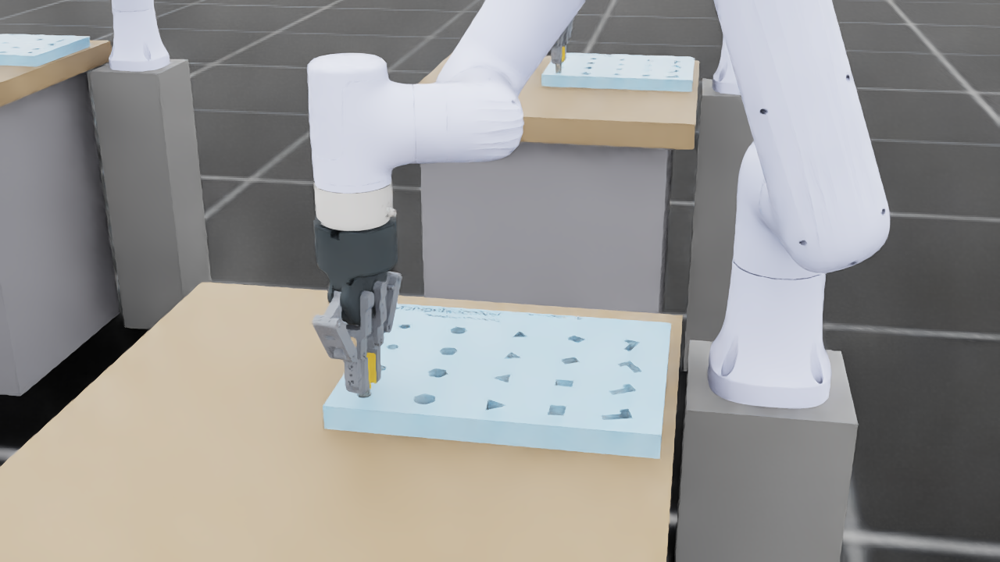

# nova5_2f85_tactile_sim

Simulation of a **Dobot NOVA5** robot arm with a **Robotiq 2F-85** gripper in
**NVIDIA Isaac Sim**, set up for the
**[ManipulationNet](https://manipulation-net.org) Peg-in-Hole** benchmark task
(NIST ATB M1 task board and steel pegs), with **Isaac Lab** environments for
reinforcement learning (RL). Fingertip tactile sensing is included as work in
progress.



**Contents:** [What you get](#what-you-get) ·
[1. Requirements](#1-requirements) · [2. Install](#2-install-from-scratch) ·
[3. First run](#3-first-run) · [4. Train with RL](#4-train-a-policy-with-rl) · [Results](#results-so-far) ·
[5. The task in detail](#5-the-task-in-detail) · [6. Repository layout](#6-repository-layout) ·
[7. Troubleshooting](#7-troubleshooting) · [Tactile](#tactile-work-in-progress) ·
[Limitations](#limitations) · [Credits](#credits-and-licences)

---

## What you get

| | |
|---|---|
| Robot | NOVA5 (Dobot's ROS 2 description) on a 0.70 m pedestal, with a Robotiq 2F-85 built from its URDF CAD: 6 finger joints coupled by PhysX mimic joints, one driven joint `finger_joint` (0–0.725 rad) |
| Benchmark | ManipulationNet Peg-in-Hole: the official board and peg CAD, 5 peg shapes (**A** circle, **B** hexagon, **C** triangle, **D** rectangle, **E** L-shape) × 4 clearance levels (**1** 3 mm, **2** 1 mm, **3** 0.1 mm, **4** 0.02 mm) = 20 sub-tasks, named like the benchmark (`A1` … `E4`) |
| RL environments | 20 Isaac Lab tasks `Nova5-MNet-PegInHole-A1-v0` … `-E4-v0`, many robots in parallel on one GPU, PPO training with RSL-RL |
| Tools | scripted baseline, screenshot capture, asset builder, unit tests |

## 1. Requirements

| | Tested with | Notes |
|---|---|---|
| OS | Ubuntu 22.04 LTS | Isaac Sim also supports 24.04; not tested here |
| GPU | NVIDIA RTX A4500, 20 GB | An RTX-class GPU is required by Isaac Sim; ≥ 8 GB VRAM for small runs, more for many parallel envs |
| NVIDIA driver | 580.178 | Check with `nvidia-smi` |
| RAM / disk | 64 GB / ~40 GB free | Isaac Sim alone is ~20 GB unpacked |
| Isaac Sim | **6.0.0** (binary zip) | in `~/isaacsim` |
| Isaac Lab | **3.0.0**, commit `28a37ce` | in `~/IsaacLab` |
| Python | 3.12 (conda) | created by Isaac Lab's installer |

You do not need ROS. You need a desktop session (or a virtual display) to open
the Isaac Sim window; everything also runs headless.

## 2. Install from scratch

### 2.1 NVIDIA driver

```bash
nvidia-smi          # must print your GPU and a driver version
```

If it does not, install the recommended driver (`sudo ubuntu-drivers install`), reboot, and check again.

### 2.2 Miniconda

Skip if `conda --version` already works.

```bash
wget https://repo.anaconda.com/miniconda/Miniconda3-latest-Linux-x86_64.sh
bash Miniconda3-latest-Linux-x86_64.sh -b -p ~/miniconda3
~/miniconda3/bin/conda init bash
exec bash
```

### 2.3 Isaac Sim 6.0

1. Download the Isaac Sim **6.0** Linux zip from NVIDIA's
   [Isaac Sim download page](https://docs.isaacsim.omniverse.nvidia.com/latest/installation/download.html)
   (free NVIDIA account).
2. Unpack it to `~/isaacsim` and run the post-install steps:
   ```bash
   mkdir -p ~/isaacsim
   unzip ~/Downloads/isaac-sim-*.zip -d ~/isaacsim
   cd ~/isaacsim
   ./post_install.sh
   ```
3. Check that it starts (the first start compiles shaders and can take several minutes):
   ```bash
   ~/isaacsim/isaac-sim.sh
   ```

### 2.4 Isaac Lab 3.0

```bash
git clone https://github.com/isaac-sim/IsaacLab.git ~/IsaacLab
cd ~/IsaacLab
git checkout 28a37ce                 # version this repo was tested with
ln -s ~/isaacsim _isaac_sim          # tell Isaac Lab where Isaac Sim is
./isaaclab.sh --conda                # creates the conda env "env_isaaclab" (Python 3.12)
conda activate env_isaaclab
./isaaclab.sh --install              # Isaac Lab + RL libraries (rsl_rl, ...)
```

Check it (opens a window with an empty scene; close it to finish):

```bash
./isaaclab.sh -p scripts/tutorials/00_sim/create_empty.py --viz kit
```

### 2.5 This repository

```bash
git clone https://github.com/Cyber-physical-Systems-Lab/nova5_2f85_tactile_sim.git ~/nova5_tactile_sim
cd ~/nova5_tactile_sim
```

All Isaac commands in this repo go through `scripts/isaac_python.sh`, which
activates the conda env, loads Isaac Sim's Python setup and puts this repo on
`PYTHONPATH`. It assumes the paths above. If yours differ, set these
before running (or add them to `~/.bashrc`):

```bash
export ISAAC_PATH=~/isaacsim            # Isaac Sim folder
export ISAACLAB_PATH=~/IsaacLab         # Isaac Lab folder
export TASK_CONDA_ROOT=~/miniconda3     # conda installation
export TASK_CONDA_ENV=env_isaaclab      # conda env made by isaaclab.sh
```

### 2.6 Build the simulation assets (once, ~1–2 min)

```bash
bash scripts/isaac_python.sh scripts/build_assets.py
```

This writes `assets/generated/` (not in git): the robot as one articulation,
the five pegs, the board, one board per target hole with its collision
geometry, and `peg_in_hole.json` with hole positions and measured clearances.
Run it again after pulling changes to `nova5_tactile/`.

### 2.7 Check the install

```bash
conda run -n env_isaaclab pip install pytest                 # once
bash scripts/isaac_python.sh -m pytest -q tests                # unit tests, no simulation, ~30 s
bash scripts/isaac_python.sh scripts/run_peg_in_hole.py --task A1 --num_envs 8 --headless
```

The second command should end with `EPISODE 0 success_rate` close to `1.0` (a scripted
policy inserting the peg in 8 parallel copies of the scene).

## 3. First run

```bash
# watch it in the Isaac Sim window (4 robots side by side)
bash scripts/isaac_python.sh scripts/run_peg_in_hole.py --task A1 --num_envs 4

# another sub-task: hexagon peg, 0.1 mm clearance
bash scripts/isaac_python.sh scripts/run_peg_in_hole.py --task B3 --num_envs 4

# headless, and save a picture
bash scripts/isaac_python.sh scripts/run_peg_in_hole.py --task A1 --num_envs 4 --headless \
    --enable_cameras --screenshot docs/media/peg_in_hole_A1.png
```

`run_peg_in_hole.py` options: `--task` (A1…E4), `--num_envs`, `--episodes`,
`--policy scripted|zero`, `--screenshot FILE` with `--screenshot_step N`,
`--trace N` (print env 0 state for N steps). The scripted policy centres the
peg over the hole from the observations, aligns its yaw and pushes down. It is
a sanity check and baseline, not a benchmark result.

## 4. Train a policy with RL

Isaac Lab's own training scripts are used; `scripts/train.py` and
`scripts/play.py` only register this repo's tasks and pass every other option
through.

```bash
# train PPO (RSL-RL) on A1 with 256 parallel envs, no window
bash scripts/isaac_python.sh scripts/train.py --rl_library rsl_rl \
    --task Nova5-MNet-PegInHole-A1-v0 --num_envs 256 --headless --max_iterations 300

# follow training curves (then open http://localhost:6006)
bash scripts/isaac_python.sh -m tensorboard.main --logdir logs/rsl_rl

# run the latest trained policy in the window
bash scripts/isaac_python.sh scripts/play.py --rl_library rsl_rl \
    --task Nova5-MNet-PegInHole-A1-v0 --num_envs 16
```

Checkpoints are saved in `logs/rsl_rl/mnet_peg_in_hole/<date-time>/model_<iteration>.pt`;
`play.py` loads the newest one (or pass `--checkpoint PATH`). Watch
`Metrics/success_rate` (fraction of envs that inserted the peg during an
episode). Hyper-parameters: `nova5_tactile/mnet/agents/rsl_rl_ppo_cfg.py`.

You can also call Isaac Lab directly:
`./isaaclab.sh train --rl_library rsl_rl --task Nova5-MNet-PegInHole-A1-v0 --external_callback nova5_tactile.tasks.register`
(with this repo on `PYTHONPATH`).

## Results so far

Measured on an RTX A4500 (2026-10-29). Success = peg inserted ≥ 20 mm during the episode.

**Scripted baseline** (`run_peg_in_hole.py`, 16 envs, 1 episode per sub-task):

| Shape \ level | 1 (3 mm) | 2 (1 mm) | 3 (0.1 mm) | 4 (0.02 mm) |
|---|---|---|---|---|
| A circle | 100 % | 88 % | 56 % | 0 % |
| B hexagon | 100 % | 100 % | 0 % | 0 % |
| C triangle | 100 % | 100 % | 0 % | 0 % |
| D rectangle | 100 % | 100 % | 0 % | 0 % |
| E L-shape | 100 % | 0 % | 0 % | 0 % |

Expected benchmark score of the script: about 10.4 of 20 points. It aligns,
then pushes straight down; at sub-millimetre clearances it jams or cannot
correct the last few tenths of a millimetre, which is what the tight levels
are meant to test.

**RL (PPO, RSL-RL)** on C2 (triangle, 1 mm), 256 envs, 200 iterations, 88 min:
success rate during training 0 % → 54 % (iteration 60) → 97 % (100) → 96–99 % (180–200).
Command as in section 4 with `--task Nova5-MNet-PegInHole-C2-v0 --max_iterations 200`.

## 5. The task in detail

**Geometry.** Hole size, position and orientation come from a cross-section of
the official board CAD. The collision geometry around the target hole is built
from exact convex pieces of that cross-section, because PhysX's SDF collision
voxels are much coarser than the 0.02–0.1 mm clearances. Measured per-side gaps
between peg and hole are in `assets/generated/peg_in_hole.json`.

**Environment** (`nova5_tactile/mnet/peg_in_hole_env.py`, config in `peg_in_hole_env_cfg.py`):

- **Start:** the matching peg is already held, 1–3 cm above its hole, with up
  to ±12 mm position and ±10° yaw error (as in Isaac Lab's Factory peg-insert task).
  All envs reset together, because the reset steps the simulation to settle the grasp.
- **Action** (4 numbers, 15 Hz): move the fingertip by Δx, Δy, Δz (up to 6 mm)
  and turn by Δyaw (up to 0.05 rad). Damped least-squares IK turns this into arm
  joint targets; the hand always points down.
- **Observation** (17 numbers): fingertip and peg position relative to the hole,
  fingertip and peg yaw errors (as sin, cos), fingertip velocity, last action.
- **Reward:** how close keypoints on the peg are to the fully inserted pose
  (Factory-style squashed distance), a bonus while inserted, a small action penalty.
- **Success:** peg bottom at least 20 mm below the board top (the board is 25 mm
  thick) and inside the hole.
- **Episode:** 8 s.

**Compared with the real benchmark:** ManipulationNet asks the robot to pick
each peg (from a feeder of your design), insert it, and go through all 20
sub-tasks in a fixed order within 3 hours, scoring 1 point per inserted peg.
Here each sub-task is a separate environment that starts with the peg in the
hand; picking, the task sequence and the time limit are not simulated.

## 6. Repository layout

| Path | Contents |
|---|---|
| `nova5_tactile/mnet/peg_in_hole.py` | Benchmark geometry from the CAD: holes, pegs, convex pieces (pure numpy) |
| `nova5_tactile/mnet/usd_assets.py` | Writes the peg and board USD files |
| `nova5_tactile/mnet/peg_in_hole_env.py`, `peg_in_hole_env_cfg.py` | Isaac Lab environment and its settings |
| `nova5_tactile/mnet/agents/rsl_rl_ppo_cfg.py` | PPO settings |
| `nova5_tactile/tasks.py` | Registers the 20 tasks with Gymnasium |
| `nova5_tactile/robot.py`, `robotiq.py`, `robot_cfg.py` | NOVA5 + 2F-85 model and actuators |
| `nova5_tactile/gripper_kinematics.py` | 2F-85 finger opening ↔ joint angle |
| `scripts/isaac_python.sh` | Runs any script with Isaac Sim + Isaac Lab |
| `scripts/build_assets.py` | Builds `assets/generated/` |
| `scripts/run_peg_in_hole.py` | Scripted / zero policy, screenshots |
| `scripts/train.py`, `scripts/play.py` | RL training and playback |
| `assets/` | Source robot and benchmark CAD, with provenance ([assets/README.md](assets/README.md)) |
| `tests/` | Unit tests that run without starting the simulator |
| `docs/` | Tactile validation notes, images |

## 7. Troubleshooting

| Symptom | Fix |
|---|---|
| `ModuleNotFoundError` for `isaaclab` | Run through `scripts/isaac_python.sh`, and check `TASK_CONDA_ENV` names the env you installed Isaac Lab into |
| `FileNotFoundError ... assets/generated/...` | Run `scripts/build_assets.py` (section 2.6) |
| Vulkan `ERROR_INCOMPATIBLE_DRIVER` over SSH | Isaac Sim needs a display even when headless on some setups: log into the desktop on that machine and `export DISPLAY=:1` (or your display) before running |
| Screenshot is black | Add `--enable_cameras` |
| First start very slow | Shader compilation on first launch; later starts are faster |
| `cannot import name 'PhysxSchema' from 'pxr'` in your own script | Import `nova5_tactile.robot` / `robotiq` only after `AppLauncher(...)` has started Isaac Sim |
| TensorBoard import errors (`google`, `absl`) | `scripts/isaac_python.sh` links these from Isaac Sim's bundled packages into `.pyshim/`; run through it |

## Tactile (work in progress)

Each inner finger carries a 22×32×3 mm pad body with a 6×9 taxel grid and two
readouts: contact taxels (PhysX contact forces binned per taxel, in newtons) and
Isaac Lab's TacSL force field. They are validated on a lift-and-hold demo, but
not yet used in the RL environment, whose robot uses rigid pads.

```bash
bash scripts/isaac_python.sh scripts/grasp_demo.py --out runs/grasp01 --device cuda:0 --headless
bash scripts/isaac_python.sh scripts/validate_static.py --out runs/static01 --device cuda:0 --headless
```

Results and known issues: [docs/validation.md](docs/validation.md). Notes from
the earlier scaffold of this repo: [docs/tactile_model_scaffold.md](docs/tactile_model_scaffold.md).

## Limitations

- Gripper drive gains and its 2 N·m cap are simulation assumptions; the 2F-85
  force controller is not modelled. Arm effort limits are synthetic (the vendor
  model has none).
- Contact at 0.02 mm clearance is at the edge of what PhysX resolves; treat
  levels 3–4 with care until compared with real hardware.
- The board is modelled exactly only within ±3 cm of the target hole; elsewhere
  its collision is plain boxes (other holes filled).

## Credits and licences

- ManipulationNet task CAD: [ManipulationNet/mnet_client](https://github.com/ManipulationNet/mnet_client) (Apache-2.0)
- NOVA5 description: [Dobot-Arm/DOBOT_6Axis_ROS2_V4](https://github.com/Dobot-Arm/DOBOT_6Axis_ROS2_V4) (MIT)
- Robotiq 2F-85 URDF and meshes: `robot_description` package (BSD-3-Clause)
- The environment follows the structure of Isaac Lab's Factory peg-insert task.

Details in [assets/README.md](assets/README.md). Parts of this repository were
written with AI assistance (Claude); review it before relying on it, and follow
your institution's guidelines on generative AI.
